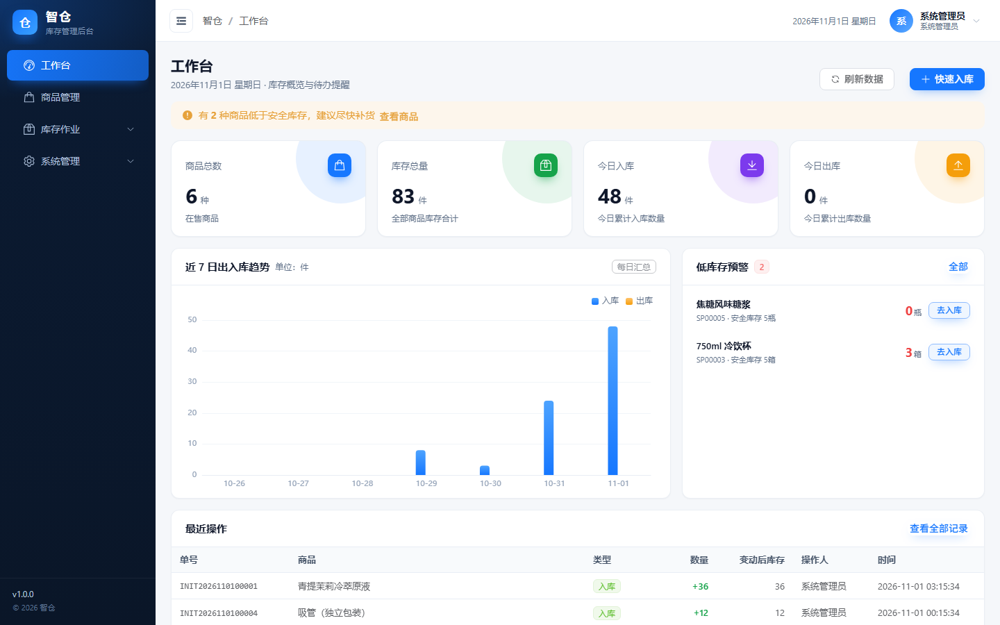

# 智仓 · 库存管理后台

面向小微企业 / 门店的轻量库存管理系统。**无需服务器、无需安装数据库**，Windows 上双击 exe 即可使用；同时提供 **PC 端** 与 **手机 H5 端** 两套独立界面。

- 后端：Python Flask 3 + SQLite（WAL）+ JWT
- PC 前端：Vue 3 + Element Plus + ECharts
- H5 前端：Vue 3 + Vant 4
- 打包：PyInstaller 6 免安装 exe（目录模式，内置前端资源）



## 一、功能一览

| 模块 | 能力 |
| --- | --- |
| 登录 / 登出 | 账号密码登录、记住账号、改密后旧会话失效、连续输错锁定 |
| 工作台 | 商品总数 / 库存总量 / 今日出入库、近 7 日趋势、低库存预警、最近操作 |
| 商品管理 | 增删改查、搜索分类、安全库存、期初入库、停用 |
| 库存作业 | 入库、出库、库存不足拦截、出入库流水（只读） |
| 用户管理 | 新增/编辑/删除、启停、重置密码、用户级菜单可见范围 |
| 权限管理 | 角色维护、按模块配置功能权限、菜单权限 |
| 菜单管理 | 菜单树维护、排序、显隐、图标、按角色配置可见范围 |
| 双端 | PC 侧边栏 + 表格；H5 底部导航 + 卡片式操作 |

## 二、快速开始（源码运行）

适合在 Trae / PyCharm / VS Code 中直接查看和调试。

```bash
# 1. 安装依赖（Python 3.10+）
pip install -r requirements.txt

# 2. 启动（首次会自动建库、写入演示数据）
python run.py
```

浏览器访问 <http://127.0.0.1:8000>，会自动按设备跳转到 `/pc/` 或 `/m/`。

也可以双击 `start.bat`（Windows，自动检查依赖）。

### 默认账号

| 账号 | 密码 | 角色 | 说明 |
| --- | --- | --- | --- |
| `admin` | `Admin@123456` | 系统管理员 | **首次登录强制修改密码** |
| `staff` | `Staff@123456` | 普通员工 | 仅出入库相关功能 |

首次启动会写入 6 条演示商品（其中 2 条低库存）。正式使用前可在「商品管理」里删除，或首次启动时设置环境变量 `SMARTSTOCK_SEED_DEMO=0` 跳过演示数据。

### 手机访问

手机与电脑连接同一 Wi-Fi，访问启动日志中提示的地址：

```
http://<电脑局域网IP>:8000/m/
```

首次运行如弹出 Windows 防火墙提示，请勾选「专用网络」并允许访问。也可以用管理员 PowerShell 手动放行：

```powershell
netsh advfirewall firewall add rule name="SmartStock 8000" dir=in action=allow protocol=TCP localport=8000
```

## 三、打包成 exe

前置条件（仅开发机需要，客户机不需要）：Python 3.10+、Node.js 18+、pnpm。

```bat
build\build_exe.bat
```

脚本会依次：

1. 构建 PC 前端并复制到 `backend/static/pc`
2. 构建 H5 前端并复制到 `backend/static/m`
3. 检查 Python 依赖
4. 调用 PyInstaller 打包（目录模式）
5. 输出 `release\智仓管理后台\`

客户机拿到的目录：

```
智仓管理后台\
├─ 智仓管理后台.exe
├─ _internal\              ← 运行库，不能删除
├─ 使用说明.md
└─ data\                   ← 首次运行自动生成
   ├─ app.db
   └─ logs\app.log
```

双击 exe 即可运行；升级时替换 exe 与 `_internal`，保留 `data` 目录即可。备份数据就是复制 `data\app.db`。

**关于单文件版**：也可以执行 `python -m PyInstaller build\app.spec` 生成 `dist\SmartStock.exe` 单文件。单文件启动时需要先解压到临时目录，首次启动稍慢，且个别杀毒软件更容易误报；交付客户建议用默认的目录模式。

> 若客户机杀毒软件拦截，请将程序目录加入白名单。

## 四、目录结构

```
smart-stock-admin/
├─ run.py                    # 启动入口
├─ start.bat                 # Windows 一键启动（源码）
├─ requirements.txt
├─ requirements-dev.txt
├─ backend/
│  ├─ app.py                 # Flask 应用工厂、静态托管
│  ├─ server.py              # waitress、端口探测、单实例、日志
│  ├─ config.py db.py models.py security.py services.py seed.py registry.py
│  ├─ api/                   # auth users roles menus products stock dashboard
│  ├─ templates/entry.html   # 按 UA 分流入口
│  ├─ static/pc|m            # 前端构建产物（仓库已内置）
│  └─ tests/test_api.py
├─ frontend-pc/              # Vue3 + Element Plus
├─ frontend-h5/              # Vue3 + Vant
├─ build/                    # app.spec（单文件）、app_dir.spec（目录版）、build_exe.bat
├─ docs/                     # 实现方案、使用说明、接口文档、截图
└─ scripts/                  # 截图 / 无头登录自检脚本（开发辅助）
```

## 五、配置项

通过环境变量调整，均有默认值：

| 变量 | 默认 | 说明 |
| --- | --- | --- |
| `SMARTSTOCK_PORT` | `8000` | 服务端口，被占用时自动顺延 |
| `SMARTSTOCK_HOST` | `0.0.0.0` | 监听地址；改为 `127.0.0.1` 则仅本机可访问 |
| `SMARTSTOCK_DATA_DIR` | exe 同级 `data` | 数据库、日志、密钥目录 |
| `SMARTSTOCK_TOKEN_HOURS` | `12` | 登录有效期（小时） |
| `SMARTSTOCK_LOW_STOCK` | `5` | 新建商品的默认安全库存 |
| `SMARTSTOCK_SEED_DEMO` | `1` | 设为 `0` 时首次启动不写入演示商品 |
| `SMARTSTOCK_NO_BROWSER` | - | 设为 `1` 时不自动打开浏览器 |

## 六、前端开发

```bash
# PC 端，http://127.0.0.1:5173
cd frontend-pc && pnpm install && pnpm dev

# H5 端，http://127.0.0.1:5174
cd frontend-h5 && pnpm install && pnpm dev
```

开发服务器已配置 `/api` 代理到 `http://127.0.0.1:8000`，先启动 Flask 即可联调。

## 七、测试

```bash
pip install -r requirements-dev.txt
python -m pytest
```

覆盖：登录与错误密码、强制改密、员工越权拦截、商品期初入库、出入库库存一致性、超卖拦截、低库存预警、角色菜单可见性、用户级菜单覆盖、删除保护、停用账号失效。

## 八、权限模型一句话说明

- **角色 → 功能权限**：决定接口与按钮（能否操作）。
- **角色 / 用户 → 菜单**：决定侧边栏（能否看见）。
- 员工的默认权限：工作台、商品查看、入库、出库、记录；无用户/角色/菜单管理权限。
- 后端每个接口独立鉴权，前端隐藏菜单只是体验层，不是安全边界。

## 九、常见问题

**Q：手机打不开页面？**
确认在同一局域网、exe 正在运行、防火墙已放行；用电脑浏览器访问 `http://<IP>:8000/m/` 先自测。

**Q：忘记管理员密码？**
关闭程序，备份后删除 `data/app.db` 会重置全部数据（首次启动会重新生成 admin）。若只想重置密码，可在另一台机器用相同版本初始化后复制 `users` 表，或联系开发者提供重置脚本。

**Q：端口被占用？**
程序会自动从 8000 向后寻找可用端口，实际地址见 `data/port.txt` 或启动日志。

**Q：数据存在哪里？**
`data/app.db`（SQLite 单文件），关闭程序后直接复制即完成备份。

## 十、文档

- [实现方案](docs/实现方案.md)
- [使用说明](docs/使用说明.md)
- [接口文档](docs/接口文档.md)
- [测试报告](docs/测试报告.md)
