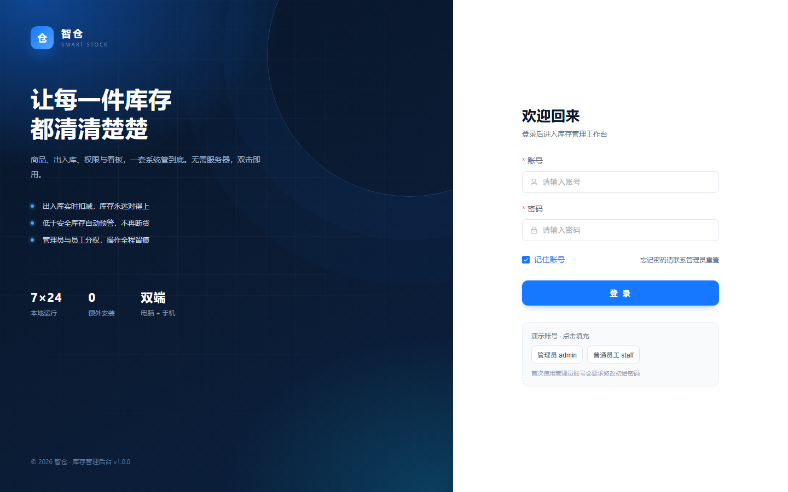
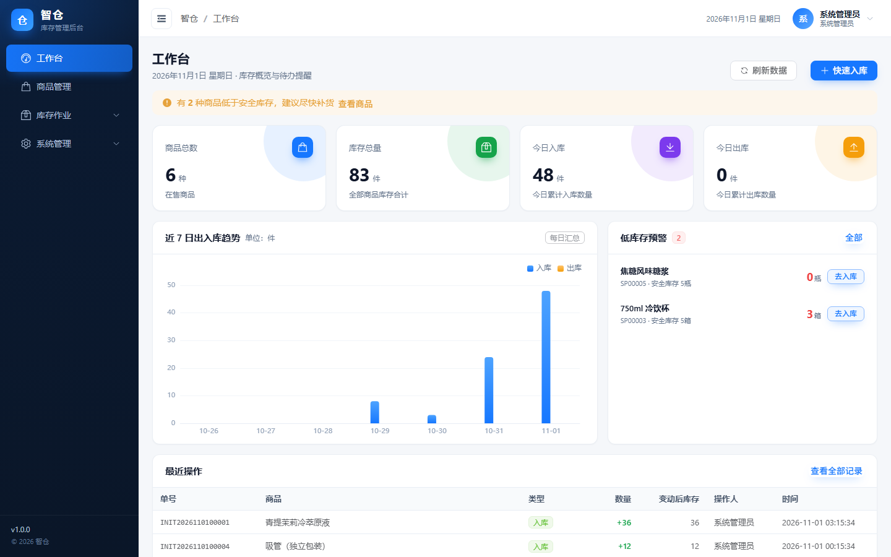
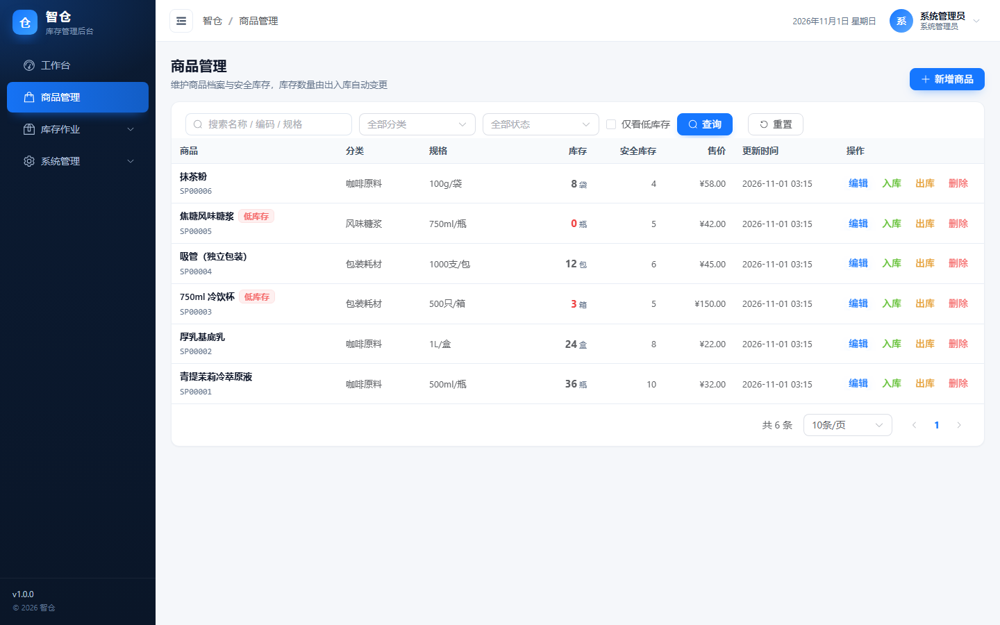
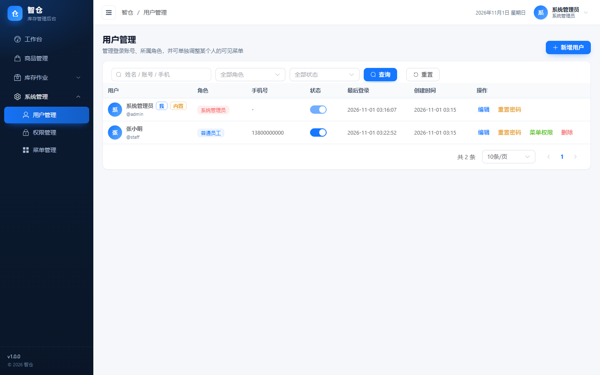
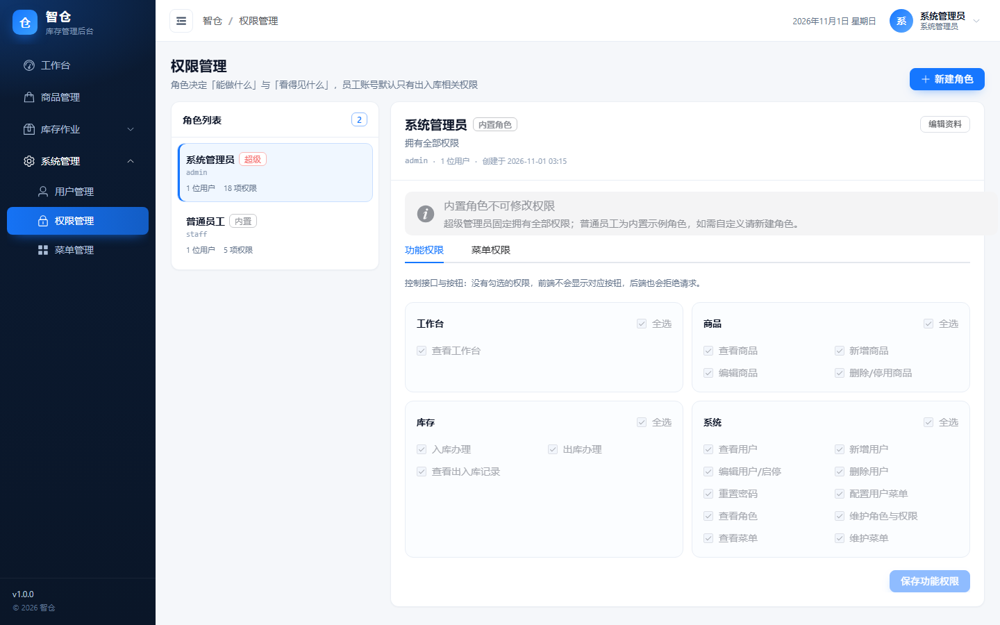
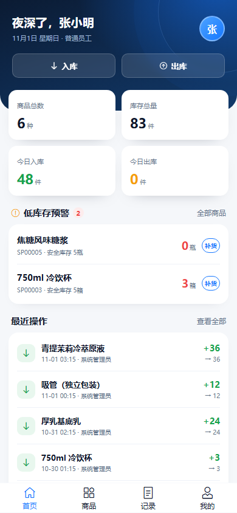
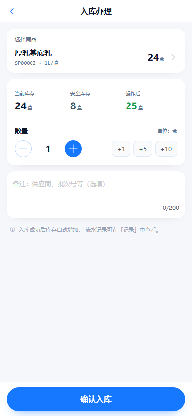

# 智仓 · 库存管理后台 使用说明

> 适用对象：门店 / 仓库管理员、普通员工
> 运行环境：Windows 电脑一台（无需服务器），手机与电脑连同一 Wi-Fi

---

## 1. 启动与登录

### 1.1 启动程序

双击 `智仓管理后台.exe`，程序会自动：

1. 在后台启动本地服务；
2. 自动打开浏览器进入登录页；
3. 首次运行自动创建数据库 `data/app.db`。

启动日志会显示两个地址：

- 本机访问：`http://127.0.0.1:8000`
- 手机访问：`http://192.168.x.x:8000`（以实际 IP 为准）

> 若 Windows 弹出防火墙提示，请勾选「专用网络」并点击「允许访问」，否则手机无法连接。

### 1.2 登录

- 电脑端：浏览器打开 `http://127.0.0.1:8000`，自动进入 `/pc/`
- 手机端：浏览器打开 `http://<电脑IP>:8000/m/`

默认账号：

| 账号 | 密码 | 角色 |
| --- | --- | --- |
| `admin` | `Admin@123456` | 系统管理员 |
| `staff` | `Staff@123456` | 普通员工 |

**管理员首次登录会强制修改密码**，修改成功后自动进入工作台。员工账号建议上线前也修改一次密码。

---

## 2. 管理员操作

### 2.1 认识工作台

登录后进入「工作台」，可以看到：

- 4 个统计卡：商品总数、库存总量、今日入库、今日出库；
- 低库存预警：库存低于安全库存的商品，点「去入库」直接补货；
- 近 7 日出入库趋势图；
- 最近操作流水。

### 2.2 新增商品

1. 左侧菜单进入「商品管理」；
2. 点击右上角「新增商品」；
3. 填写商品名称、分类、规格、单位、安全库存、售价等；
4. 「期初库存」大于 0 时，会自动生成一条「期初入库」记录；
5. 保存后商品出现在列表中。

> 商品编码留空会自动生成（如 `SP00007`）。已有出入库记录的商品不能删除，只能「停用」。

### 2.3 入库 / 出库

1. 菜单进入「入库办理」或「出库办理」；
2. 搜索并选择商品，系统会显示当前库存与操作后库存；
3. 填写数量（可点 +1 / +5 / +10 快捷调整）与备注；
4. 点击「确认入库 / 确认出库」。

- 入库：库存自动增加；
- 出库：库存自动扣减，**库存不足会被拦截**，不会出现负库存；
- 每次操作都会生成一条流水，可在「出入库记录」查看，记录只读不可改。

### 2.4 低库存预警

当商品库存 **低于** 安全库存（默认 5 件）时：

- 工作台顶部出现黄色提示；
- 工作台右侧「低库存预警」列出商品；
- 商品列表中该商品库存显示为红色并带「低库存」标签。

安全库存可在编辑商品时按商品单独设置。

### 2.5 用户管理

菜单「系统管理 → 用户管理」：

- **新增用户**：填写账号、姓名、角色、初始密码；可设置首次登录强制改密；
- **编辑**：修改姓名、手机号、所属角色；
- **重置密码**：设置新密码，该用户下次登录需再次修改；
- **启用 / 停用**：停用后该账号立即无法登录，已登录会话也会失效；
- **菜单权限**：可让某个用户「跟随角色」或「单独配置」可见菜单；
- **删除**：内置 admin、当前登录账号不可删除。

### 2.6 权限管理（角色）

菜单「系统管理 → 权限管理」：

- 左侧是角色列表，右侧是该角色的「功能权限」与「菜单权限」；
- **功能权限**：控制能否新增/编辑/删除商品、能否办理出入库、能否管理用户等；
- **菜单权限**：控制侧边栏能看到哪些页面；
- 勾选页面菜单时，系统会自动补齐该页面的访问权限，避免「看得见却打不开」；
- 内置角色（系统管理员 / 普通员工）不可删除，普通员工可另建角色替代。

### 2.7 菜单管理

菜单「系统管理 → 菜单管理」：

- 修改菜单名称、图标、排序、显示/隐藏；
- 通过「可见范围」配置哪些角色能看到该菜单；
- 内置页面菜单不可删除；可新增自定义分组用于归类；
- 修改后，相关用户刷新页面即可生效。

> 建议不要隐藏「菜单管理」本身，否则管理员将无法从界面进入该功能。

---

## 3. 员工操作

普通员工登录后只有：

- 工作台（查看库存与预警）
- 商品（只读，可搜索查看）
- 入库办理 / 出库办理
- 出入库记录
- 我的

员工无法看到「系统管理」，直接在地址栏输入用户管理地址也会被拦截（403）。

---

## 4. 手机端（H5）

手机浏览器访问 `http://<电脑IP>:8000/m/`，登录后：

- 底部四个入口：首页 / 商品 / 记录 / 我的；
- 首页可直接点「入库」「出库」，或从低库存预警点「补货」；
- 商品列表点进详情，可查看库存、规格、价格和最近流水；
- 入库/出库支持搜索商品、数量步进、快捷 +1/+5/+10；
- 管理员在「我的」中可进入用户管理（启停账号、重置密码）；
- 角色权限、菜单配置等复杂操作请在电脑端完成。

  
  

> 手机访问依赖局域网：手机与电脑必须连同一个 Wi-Fi，且电脑防火墙放行程序端口。

---

## 5. 数据备份与迁移

- 所有数据保存在程序目录下的 `data/app.db`；
- **备份**：关闭程序后复制 `data` 文件夹（或只复制 `app.db`）；
- **恢复**：把备份的 `app.db` 放回 `data` 目录后启动；
- **换电脑**：复制整个程序目录（exe + data）到新电脑即可。

建议每周备份一次，并把备份文件放到 U 盘或网盘。

---

## 6. 常见问题

**手机打不开页面？**
1. 确认手机与电脑在同一 Wi-Fi；
2. 确认程序正在运行；
3. 关闭或放行 Windows 防火墙；
4. 用电脑浏览器访问 `http://<IP>:8000/m/` 自测。

**提示端口被占用？**
程序会自动换端口启动，实际端口见 `data/port.txt`。

**忘记密码？**
联系管理员在「用户管理 → 重置密码」中重置；若管理员密码也忘记，请先备份数据，联系开发者处理。

**误删了菜单 / 权限？**
内置菜单不能删除；若把某角色权限改乱，可用 admin 账号重新勾选。admin 角色始终拥有全部权限。

**想清空演示数据重新开始？**
关闭程序，删除 `data/app.db`，重新启动即可（会恢复默认账号与演示数据）。
