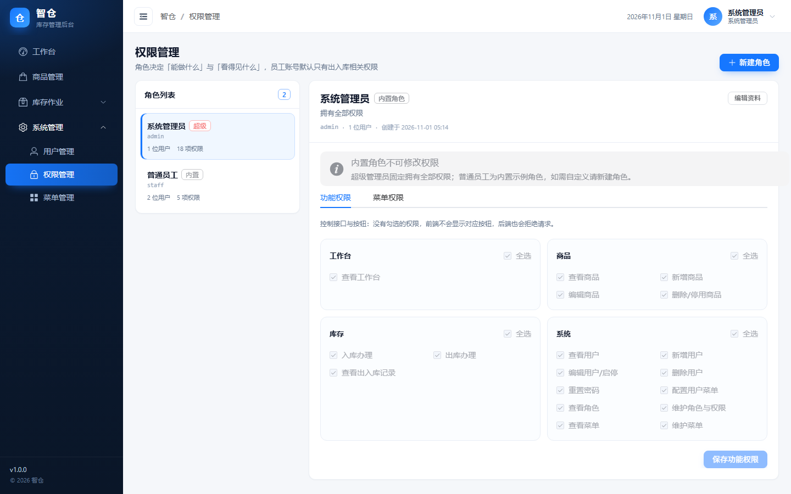
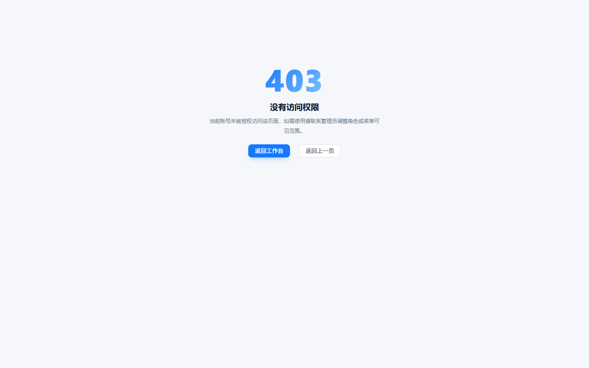
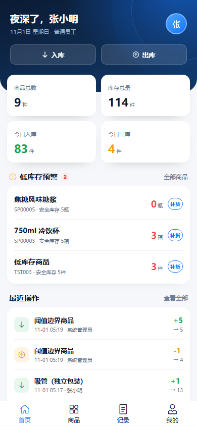
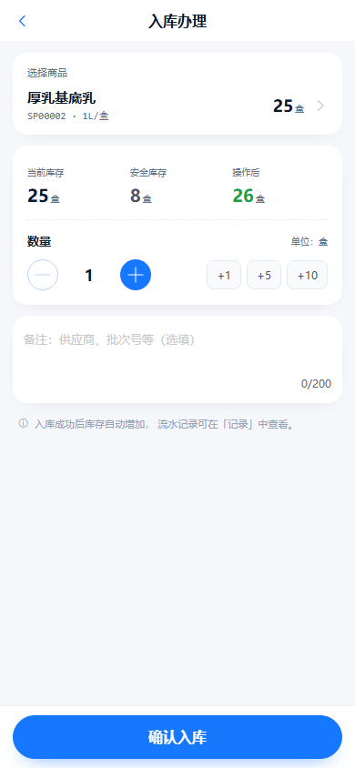
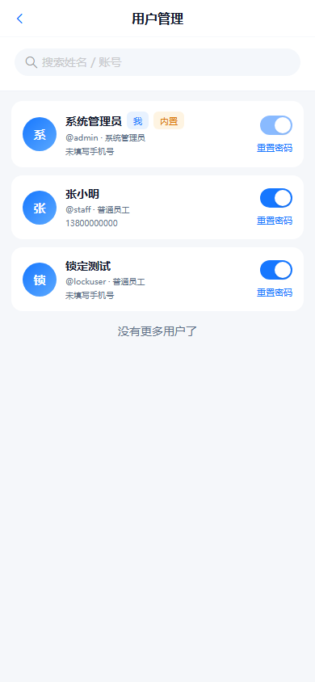

# 智仓 · 库存管理后台 测试报告

| 项目 | 内容 |
| --- | --- |
| 报告版本 | v1.0 |
| 测试日期 | 2026-11-01 |
| 被测版本 | v1.0.0（源码 + release 打包版） |
| 测试类型 | 功能测试、接口测试、权限与安全测试、兼容性测试、并发测试、打包验收 |
| 测试结论 | **通过，建议发布**；本轮发现 1 个高优先级缺陷，已修复并回归通过 |

---

## 1. 结论摘要

| 测试层 | 用例/检查项 | 通过 | 失败 |
| --- | ---: | ---: | ---: |
| 后端回归（pytest） | 15 | 15 | 0 |
| 真实 HTTP 接口（70 项） | 70 | 70 | 0 |
| PC / H5 页面巡检（Edge 无头） | 24 | 24 | 0 |
| 关键交互（登录、新增商品、出入库） | 5 | 5 | 0 |
| 打包 exe 验收 | 7 | 7 | 0 |
| 低库存阈值边界（补充验证） | 1 | 1 | 0 |

- **阻断性问题：0**
- **本轮新发现缺陷：1 个**（`BUG-001` 端口探测误判，已修复并增加回归用例）
- 核心链路“登录 → 商品 → 入库/出库 → 库存与流水 → 看板预警”全部打通，权限隔离符合要求。

---

## 2. 测试环境

| 项目 | 配置 |
| --- | --- |
| 操作系统 | Windows 11（10.0.26200） |
| 浏览器 | Microsoft Edge 141.0.3537.85（无头模式） |
| Python | 3.12.8 |
| 后端依赖 | Flask 3.0.3、SQLAlchemy 2.0.35、PyJWT 2.9.0、waitress 3.0.0 |
| 测试框架 | pytest 8.3.3 |
| 打包工具 | PyInstaller 6.11.1 |
| 前端构建 | Node.js 24.21.0、pnpm 11.28.5、Vite 5.4.21 |
| 数据库 | SQLite 3（WAL 模式），独立测试库（测试后已清理） |
| 分辨率 | PC 1440×900；H5 390×844、360×800、430×932 |
| 测试数据 | 首次启动种子数据 + 测试过程中创建的临时商品/用户/角色 |

---

## 3. 测试方法

1. **接口层**：启动真实 Flask 服务，使用独立测试库，通过 HTTP 逐项调用 70 个接口用例，覆盖正常流程、边界值、越权与异常输入。
2. **页面层**：Edge 无头浏览器 + CDP，按管理员/员工两种身份注入登录态，遍历 PC 与 H5 全部页面，检查关键文案、JS 运行时异常、横向溢出与路由跳转。
3. **交互层**：自动填写并提交登录表单、PC 新增商品抽屉、PC/H5 入库表单，校验页面提示与数据库结果。
4. **打包层**：使用 `release\智仓管理后台` 全新数据启动 exe，验证首次初始化、端口顺延、登录与两端页面。
5. **安全/性能**：SQL 注入字符串、篡改 token、越权接口、分页上限、重复密码锁定；看板接口 20 次耗时统计；10 线程并发入库。

---

## 4. 分模块结果

### 4.1 认证与登录（14/14）

| 用例 | 预期 | 结果 |
| --- | --- | --- |
| 管理员正确登录 | 返回 token、用户、4 组菜单，标记首次改密 | 通过 |
| 错误密码 | 401，提示“账号或密码错误” | 通过 |
| 未改初始密码访问业务接口 | 403，`code=1002` | 通过 |
| 弱密码修改 | 400，拒绝纯数字 | 通过 |
| 修改密码 | 成功并签发新 token | 通过 |
| 改密后旧 token | 401 失效 | 通过 |
| 员工登录 | 仅“工作台/商品管理/库存作业”三组菜单 | 通过 |
| 员工访问用户/角色/菜单接口 | 均 403 | 通过 |
| 伪造 token | 401 | 通过 |
| 退出登录 | 200 | 通过 |
| 连续 5 次错误密码 | 第 6 次正确密码也被锁定 10 分钟 | 通过 |

### 4.2 商品管理（10/10）

| 用例 | 预期 | 结果 |
| --- | --- | --- |
| 新增商品（编码留空） | 自动生成 `SP000xx`，库存 0 | 通过 |
| 期初库存 | 库存=10，并生成“期初入库”流水 | 通过 |
| 重复编码 | 409 拒绝 | 通过 |
| 编辑商品 | 名称/售价/安全库存更新，库存不变 | 通过 |
| 搜索 + 低库存筛选 | 关键词命中，0 库存进入低库存列表 | 通过 |
| 不存在商品 | 404 | 通过 |
| 删除无流水商品 | 成功 | 通过 |
| 删除有流水商品 | 409，提示改为停用 | 通过 |
| 非法安全库存（-1） | 400 | 通过 |
| 低库存商品标记 | `low_stock=true` | 通过 |

### 4.3 库存作业（8/8）

| 用例 | 预期 | 结果 |
| --- | --- | --- |
| 入库 5 件 | 10 → 15，流水 `IN` | 通过 |
| 出库 3 件 | 15 → 12，流水 `OUT`，前后库存正确 | 通过 |
| 出库 999 件 | 409“库存不足”，库存仍为 12 | 通过 |
| 数量 0 | 400 | 通过 |
| 流水按商品/类型/编码筛选 | 结果正确 | 通过 |
| 最近流水 limit | 不超过指定条数 | 通过 |
| 停用商品出入库 | 409 拒绝 | 通过 |
| 10 线程并发入库 | 全部 200，库存 12 → 22，准确 +10 | 通过 |

### 4.4 用户管理（10/10）

| 用例 | 预期 | 结果 |
| --- | --- | --- |
| 新增员工账号 | 创建成功，角色正确 | 通过 |
| 重复账号 | 409 | 通过 |
| 列表搜索 | 命中，响应不包含密码哈希 | 通过 |
| 编辑姓名/手机号 | 更新成功 | 通过 |
| 重置密码 | 旧密码失效，新密码要求改密 | 通过 |
| 未改密访问业务接口 | 403/1002 | 通过 |
| 停用账号 | 无法登录，提示已停用 | 通过 |
| 删除/停用自己 | 409 拒绝 | 通过 |
| 用户级菜单“单独配置” | 员工仅见“商品管理”，恢复继承后复原 | 通过 |
| 删除用户 | 200 | 通过 |

### 4.5 角色与权限（9/9）

| 用例 | 预期 | 结果 |
| --- | --- | --- |
| 新建角色 | 成功 | 通过 |
| 角色标识重复 | 409 | 通过 |
| 保存菜单 | 自动补齐 `product:view` 页面权限 | 通过 |
| 保存功能权限 | 权限集合正确 | 通过 |
| 自定义角色登录 | 仅见商品菜单，可查商品/流水，访问用户接口 403 | 通过 |
| 修改角色资料 | 成功 | 通过 |
| 修改/删除内置角色 | 409 拒绝 | 通过 |
| 删除仍有用户的角色 | 409 拒绝 | 通过 |
| 移除用户后删除角色 | 200 | 通过 |

### 4.6 菜单管理（9/9）

| 用例 | 预期 | 结果 |
| --- | --- | --- |
| 菜单树 | 4 个根节点、共 10 个菜单，带角色信息 | 通过 |
| 页面注册表 | 8 个已注册页面，全部已上架 | 通过 |
| 新增分组 | 成功 | 通过 |
| 编辑分组 | 名称/排序/显隐更新 | 通过 |
| 配置可见角色 | 角色列表包含员工 | 通过 |
| 隐藏“菜单管理” | 409 拒绝，防止管理员自锁 | 通过 |
| 删除内置菜单 | 409 拒绝 | 通过 |
| 员工维护菜单 | 403 | 通过 |
| 删除自定义分组 | 200 | 通过 |

### 4.7 工作台看板（3/3）

| 用例 | 预期 | 结果 |
| --- | --- | --- |
| 统计卡 | 商品总数、库存总量、今日出入库正确 | 通过 |
| 低库存预警 | 商品进入列表，数量正确 | 通过 |
| 7 日趋势 | 返回 7 条，今日数据包含测试入库量 | 通过 |

补充边界验证（手工脚本）：

- 安全库存 5、库存 5 → `low_stock=false`；
- 出库 1 件后库存 4 → `low_stock=true`，并进入看板预警列表；
- 验证了需求中“低于 5 件才预警”的严格小于语义。

### 4.8 安全与边界（6/6 + 1 项性能）

| 用例 | 预期 | 结果 |
| --- | --- | --- |
| 搜索框 SQL 注入 `' OR 1=1 --` | 200，结果 0 条，无注入 | 通过 |
| 分页 `page_size=999` | 服务端限制为 100 | 通过 |
| 未知接口 | JSON 404 | 通过 |
| 错误请求方法 | 405 | 通过 |
| 篡改 token | 401 | 通过 |
| 特殊字符商品名 | 按原文保存；前端以纯文本渲染，未执行脚本 | 通过 |
| 看板 20 次请求 | 平均 13.5ms，P95 21.2ms，最大 27.5ms | 通过 |

---

## 5. 页面巡检结果（24/24）

| 范围 | 页面 | 结果 |
| --- | --- | --- |
| 入口 | `/` 按 UA 分流到 `/pc/`、`/m/` | 2/2 |
| PC 管理员 | 工作台、商品、入库、出库、记录、用户、权限、菜单、个人中心 | 9/9 |
| PC 员工 | 工作台（无系统管理）、越权访问显示 403 | 2/2 |
| H5 员工 | 首页、商品列表、商品详情、入库、出库、记录、我的、修改密码 | 8/8 |
| H5 管理员 | 用户管理 | 1/1 |
| 响应式 | H5 360px / 390px / 430px 无横向滚动 | 2/2 |

所有页面均满足：

- 无 JavaScript 运行时异常；
- 关键区域文案存在；
- 移动端无横向溢出；
- 员工页面不出现“用户管理/权限管理/菜单管理”。

<p align="center">
  
  
</p>
<p align="center">
  
  
  
</p>

---

## 6. 关键交互测试

| 场景 | 操作 | 结果 |
| --- | --- | --- |
| PC 登录 | 输入员工账号密码，点击登录 | 跳转 `/pc/dashboard`，无报错 |
| H5 登录 | 输入员工账号密码，点击登录 | 跳转 `/m/home`，无报错 |
| PC 新增商品 | 打开抽屉、填写名称、保存 | 列表出现新商品，提示成功 |
| PC 入库 | 选择商品、数量 1、确认入库 | 库存 +1，提示成功，流水新增 |
| H5 入库 | 选择商品、数量 1、确认入库 | 库存 +1，提示成功 |

---

## 7. 缺陷记录

### BUG-001 端口探测在 Windows 下误判占用端口

| 项目 | 内容 |
| --- | --- |
| 严重级别 | 高（影响打包版启动） |
| 发现阶段 | exe 打包验收 |
| 现象 | 8000 端口已被其他服务占用时，exe 仍把 8000 写入 `port.txt`，健康检查命中的是别的服务，登录返回 401 |
| 根因 | `pick_port()` 使用了 `SO_REUSEADDR`，Windows 允许对已监听端口再次 bind，导致“端口空闲”误判 |
| 修复 | 移除 `SO_REUSEADDR`，仅做独占 bind 探测 |
| 回归用例 | 新增 `test_port_probe_skips_occupied_port` |
| 回归结果 | pytest 15/15 通过；exe 在 8000/8001 被占用时自动使用 8002，健康检查 200、登录成功、PC/H5 页面正常 |
| 状态 | 已关闭 |

本轮未发现其他功能缺陷。

---

## 8. 性能与并发

| 指标 | 结果 |
| --- | --- |
| 看板接口平均响应 | 13.5ms |
| P95 | 21.2ms |
| 最大 | 27.5ms |
| 10 并发入库 | 全部成功，库存精确 +10，无超卖、无丢失更新 |
| 数据库 | SQLite WAL，写事务 `BEGIN IMMEDIATE` 串行化 |

> 本机测试数据量较小（十余种商品、数十条流水），性能数据仅代表单机轻量场景。建议正式使用时并发不超过 20 人，并定期备份。

---

## 9. 打包验收

| 检查项 | 结果 |
| --- | --- |
| 全新数据首次启动 | 自动建库、写入种子数据、生成 `data/` |
| 端口 8000/8001 被占用 | 自动顺延到 8002 |
| 健康检查 | 200，返回 `smart-stock` |
| 默认管理员登录 | 成功，`must_change_password=true` |
| PC 页面 | `/pc/` 200 |
| H5 页面 | `/m/` 200 |
| 数据文件 | `app.db`、`app.db-wal`、`logs/`、`port.txt` 正常生成 |

交付包：`release\智仓管理后台\`，约 45.2MB，exe 8.03MB。

---

## 10. 未覆盖范围与残余风险

1. **浏览器矩阵**：仅在 Edge 141 无头模式验证；Chrome、Firefox、Safari 及真实 iOS/Android 设备未实测。
2. **单实例行为**：代码有文件锁与“已运行则打开浏览器”逻辑，但自动测试会拉起可见浏览器，本轮未做自动化验证，建议交付前手工双击两次确认。
3. **长时间稳定性**：未做 24 小时连续运行与大量流水（10 万条以上）压力测试。
4. **备份恢复演练**：已验证数据库落在 `data/app.db`，未做真实“备份→删除→恢复”演练。
5. **移动端管理能力**：按既定范围，手机端仅支持用户列表、启停、重置密码；新增用户、角色与菜单配置在 PC 端。
6. **网络暴露**：默认监听 `0.0.0.0` 以支持手机访问，HTTP 明文，仅建议在可信局域网使用；如需公网访问应加 HTTPS 反向代理。

---

## 11. 测试数据与复现

- 测试库：`build/test-run-data`（独立于正式 `data/`，测试后已清理）
- 接口结果：`build/test-artifacts/api-results.json`
- 页面巡检结果：`build/test-artifacts/ui-results.json`
- 页面截图：`build/test-artifacts/ui/`
- 测试账号：`admin`（测试中改为 `Admin@2026`）、`staff / Staff@123456`

复现命令：

```bash
# 1. 启动测试服务（独立数据目录）
set SMARTSTOCK_DATA_DIR=build/test-run-data
python run.py

# 2. 接口全量测试
python scripts/e2e_api.py

# 3. 页面巡检（需 Edge 远程调试端口 9222）
node scripts/ui_sweep.mjs

# 4. 后端回归
python -m pytest
```

---

## 12. 发布建议

当前版本可以交付客户试用，建议：

1. 交付前在目标电脑上手工双击两次 exe，确认单实例与浏览器打开行为；
2. 用客户自己的手机（iOS + Android 各一台）走一遍 H5 登录与出入库；
3. 上线前修改 `admin` 初始密码，并按实际商品删除演示数据；
4. 约定每周备份 `data/app.db`。

**测试结论：通过，建议按上述建议完成现场验收后发布。**
